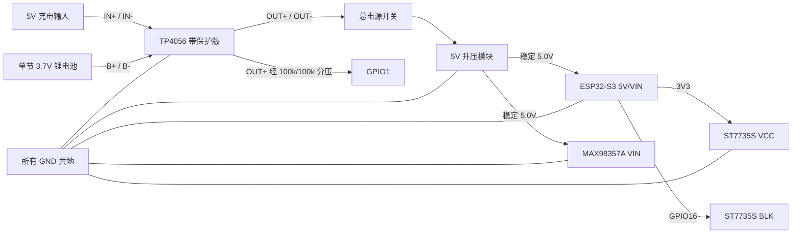

# ESP32-S3 智能语音机器人接线

本图对应 `esp32_cloud_ota_device` 当前固件。目标主控是带 16 MB Flash、OPI PSRAM 的 ESP32-S3 开发板；不同开发板丝印位置可能不同，接线时以 **GPIO 编号** 为准，不要只按排针物理顺序照搬。

## 总体电源路径



TP4056 只负责单节锂电池充电；它不会升压。ESP32 和功放要从升压模块得到稳定 5V：

1. 断开 ESP32、功放和显示屏。
2. 电池接 `B+ / B-`，总开关和升压模块接 `OUT+ / OUT-`。
3. 打开总开关，用万用表把升压输出调到 `5.0V`。
4. 再把升压 `5V / GND` 分别接到 ESP32 的 `5V/VIN / GND` 和 MAX98357A 的 `VIN / GND`。
5. ST7735S 从 ESP32 的 `3V3` 供电，不从升压 5V 供电。

建议升压模块持续输出能力至少 5V/2A。小容量锂电池不要直接使用 TP4056 常见的 1A 默认充电电流，应按电芯允许充电电流调整模块 `RPROG`。只有 `B+ / B-`、没有 `OUT+ / OUT-` 的 TP4056 板通常不含完整的放电保护输出。

普通 TP4056 没有真正的 load sharing / power path。若机器人需要开机时同时充电，应使用带电源路径的充电模块；否则充电终止判断可能不准。USB 烧录时建议关闭升压总开关，避免开发板 USB 5V 与升压 5V 互相回灌；若必须同时存在，应增加肖特基二极管或理想二极管电源 OR-ing。

## 四路 SG90 180°舵机

本次采用直接输出角度的简单控制，上电后 1、2 号为 0°，3、4 号为 180°。引脚避开现有屏幕、I2S、按键和规划的 GPIO8～11 步进电机接口。

| 舵机 | 信号线（常见橙/黄线） | 默认角度 |
| --- | --- | --- |
| 1 号 | GPIO12 | 0° |
| 2 号 | GPIO13 | 0° |
| 3 号 | GPIO14 | 180° |
| 4 号 | GPIO17 | 180° |

四个舵机红线接独立稳压舵机电源正极，棕/黑线接电源 GND，并将该 GND 接 ESP32 GND；以实物线序为准。SG90 额定电压可先按厂家 4.8 V 规格选择，常见模块使用约 5 V；核对购买型号的允许电压。舵机电流不要经过开发板的 3V3 稳压器或 USB/5V 排针再分配，信号 GPIO 只接信号线。使用两路独立电源时只共地，不要把两个电源的正极直接并联。

前面的 **5V/2A 建议不包括四个舵机**。舵机电源按四路同时启动/堵转峰值之和选取并留余量；不能只按空载电流计算或直接沿用小型升压板。舵机供电从电源入口单独分支，地线直接回电源入口，避免大电流经过麦克风/ESP32 地线。可在舵机供电分支附近加 470～1000 µF 电解电容和 0.1 µF 陶瓷电容改善瞬态，但电容不能代替足够的电源电流。

```text
舵机电源 + ──┬── 1号红线    ESP32 GPIO12 ── 1号信号线
             ├── 2号红线    ESP32 GPIO13 ── 2号信号线
             ├── 3号红线    ESP32 GPIO14 ── 3号信号线
             └── 4号红线    ESP32 GPIO17 ── 4号信号线
舵机电源 GND ── 四个舵机棕/黑线 ── ESP32 GND
```

先断电接线，首次上电先不安装连杆负载。程序使用 50 Hz、暂定 500～2500 µs 脉宽，实际端点随 SG90 批次变化；如果 0°/180°顶住或持续嗡鸣，应断电并收窄 `robot_servos.h` 的脉宽范围。软件角度是目标指令，没有位置反馈。串口 `460800` 波特率发送 `/servo all 90 90 90 90` 可测试转动，`/servo home` 恢复默认位置，`/servo off` 关闭控制脉冲。不要持续堵转测试。

参考：[TowerPro SG90 规格](https://towerpro.com.tw/product/sg90-7/)、[Espressif LEDC 文档](https://docs.espressif.com/projects/arduino-esp32/en/latest/api/ledc.html)、[Adafruit 舵机脉宽与行程校准](https://learn.adafruit.com/using-servos-with-circuitpython?view=all)。

## ST7789 / M200T 七针屏（当前默认）

当前默认驱动为 `M200T_ST7789_240X320_7PIN`，按原生竖屏 240×320 初始化，再旋转为横屏 320×240；保留设备网页切换 ST7735S 的功能。完整帧缓冲只在 PSRAM 中分配，未启用 OPI PSRAM 时大屏显示会报告初始化失败，避免占满音频所需的内部 RAM。

| ST7789 丝印 | ESP32-S3 |
| --- | --- |
| GND | GND |
| VCC / VDD | 3V3 |
| SCL / SCK | GPIO4 |
| SDA / MOSI | GPIO5 |
| RES / RST | GPIO6 |
| DC | GPIO7 |
| CS | GPIO15 |

当前 M200T 七针模块无独立 BLK，引脚 GPIO16 不作为它的背光输出。页面顶部显示联网后的 IP，配网模式下显示热点 IP。

## ST7735S 显示屏（兼容选项）

固件按 1.8 英寸、128×160、ST7735S black-tab 初始化，横屏显示为 160×128。

| ST7735S 丝印 | ESP32-S3 | 功能 |
| --- | --- | --- |
| `VCC` | `3V3` | 显示逻辑和模组供电 |
| `GND` | `GND` | 共地 |
| `SCL` / `SCK` / `CLK` | `GPIO4` | SPI 时钟 |
| `SDA` / `MOSI` / `DIN` | `GPIO5` | SPI 数据，ESP32 → 屏幕 |
| `RES` / `RST` | `GPIO6` | 屏幕复位 |
| `DC` / `A0` / `RS` | `GPIO7` | 数据/命令选择 |
| `CS` | `GPIO15` | 片选 |
| `BLK` / `BL` / `LED` | `GPIO16` | 固件通过 5 kHz PWM 调背光，后台可设置 5–100%；裸 LED 输入串 100Ω |

按照片中屏幕接口从 `GND` 到 `BLK` 的顺序接线：

```text
ST7735S                         ESP32-S3 靠屏幕一侧排针
GND   ------------------------- GND
VDD   ------------------------- 3V3
SCL   ------------------------- GPIO4
SDA   ------------------------- GPIO5
RST   ------------------------- GPIO6
DC    ------------------------- GPIO7
CS    ------------------------- GPIO15
BLK   ------------------------- GPIO16
```

此屏只写不读，所以 `MISO` 不接。若颜色反相或画面整体偏移，先确认模组是不是 green-tab/128×128 版本；当前代码在 `robot_display.cpp` 中使用 `INITR_BLACKTAB`。

## 开始说话与强制中断按钮

两个按钮均使用常开轻触按键和 ESP32 内部上拉，不需要外接上拉电阻。

```text
GPIO2  ----[ 开始说话按钮 ]---- GND
GPIO47 ----[ 强制中断按钮 ]---- GND
```

| 按钮 | GPIO | 固件行为 |
| --- | --- | --- |
| 开始说话 | `GPIO2` | 按住开始录音，松开后上传云端 |
| 强制中断 | `GPIO47` | 录音、等待回答或播放时取消当前轮次 |
| 开发板 BOOT | `GPIO0` | 不再作为日常说话键，保留给烧录/恢复 |

长导线容易拾取干扰。按钮线超过约 20 cm 时，可在 GPIO 与 GND 间并联 0.1µF 电容，按钮仍接 GPIO 与 GND 之间。

## 电池电压检测

```text
TP4056 OUT+ ---- 100kΩ ----+---- GPIO1
                           |
                         100kΩ
                           |
TP4056 OUT- ---------------+---- GND
                           |
                         0.1µF
                           |
                          GND
```

两个 100kΩ 电阻构成 1:1 分压，满电 4.2V 在 GPIO1 上约为 2.1V。0.1µF 电容用于抑制升压模块和功放造成的采样波动。禁止把电池或 `OUT+` 直接接到 GPIO1。GPIO1 电池检测、音量电位器、亮度电位器三选一；未接分压时保持电池检测关闭，屏幕电池图标显示 `?`。亮度旋钮两端接 3V3/GND，滑臂接 GPIO1；在后台“屏幕与相册”启用前先关闭音量旋钮模式。

## 原有音频模块

| 模块引脚 | ESP32-S3 / 电源 | 说明 |
| --- | --- | --- |
| INMP441 `VDD` | `3V3` | 不接 5V |
| INMP441 `GND` | `GND` | 共地 |
| INMP441 `SCK/BCLK` | `GPIO42` | 与功放共享 I2S 时钟 |
| INMP441 `WS/LRCL` | `GPIO41` | 与功放共享帧时钟 |
| INMP441 `SD` | `GPIO21` | 麦克风数据输入 |
| INMP441 `L/R` | `GND` | 选择左声道 |
| MAX98357A `VIN` | 升压模块 `5V` | 不从 ESP32 3V3 取电 |
| MAX98357A `GND` | `GND` | 共地 |
| MAX98357A `BCLK` | `GPIO42` | 与麦克风共享 |
| MAX98357A `LRC` | `GPIO41` | 与麦克风共享 |
| MAX98357A `DIN` | `GPIO40` | 播放数据输出 |
| MAX98357A `SD/EN` | `GPIO39` | 静音与使能 |
| MAX98357A `SPK+ / SPK-` | 喇叭两端 | 两端都不能接 GND |
| 音量或亮度电位器滑臂（可选） | `GPIO1` | 音量、亮度、电池检测三选一；两端分别接 3V3、GND |

## GPIO 总表

| GPIO | 用途 |
| ---: | --- |
| 0 | BOOT / 烧录恢复 |
| 1 | 电池分压 ADC / 音量电位器 / 亮度电位器（三选一，出厂均未启用） |
| 2 | 开始说话按钮 |
| 4 | TFT SCL/SCK |
| 5 | TFT SDA/MOSI |
| 6 | TFT RST |
| 7 | TFT DC |
| 12 | 1 号 SG90 信号，默认 0° |
| 13 | 2 号 SG90 信号，默认 0° |
| 14 | 3 号 SG90 信号，默认 180° |
| 15 | TFT CS |
| 16 | TFT BLK 背光 |
| 17 | 4 号 SG90 信号，默认 180° |
| 21 | INMP441 SD |
| 39 | MAX98357A SD/EN |
| 40 | MAX98357A DIN |
| 41 | I2S WS / LRC，共享 |
| 42 | I2S BCLK / SCK，共享 |
| 47 | 强制中断按钮 |

## 上电前检查

- 升压输出已经用万用表确认是 5.0V，不高于 5.2V。
- ST7735S VCC 接 3V3，而不是 5V 或电池 OUT+。
- 当前未接电池/TP4056 时，固件默认关闭电池 ADC。以后接入电池分压后，将
  `robot_display.h` 中的 `BATTERY_MONITOR_ENABLED` 改为 `true`；电池 ADC 使用
  GPIO1（ADC1），不能同时安装 GPIO1 音量或亮度电位器。
- INMP441 VDD 接 3V3。
- 所有模块共地。
- 电池极性、TP4056 的 `B` 与 `OUT` 端没有接反。
- 喇叭只接 `SPK+ / SPK-`，不接地。
- 首次 USB 烧录时关闭电池升压总开关。
